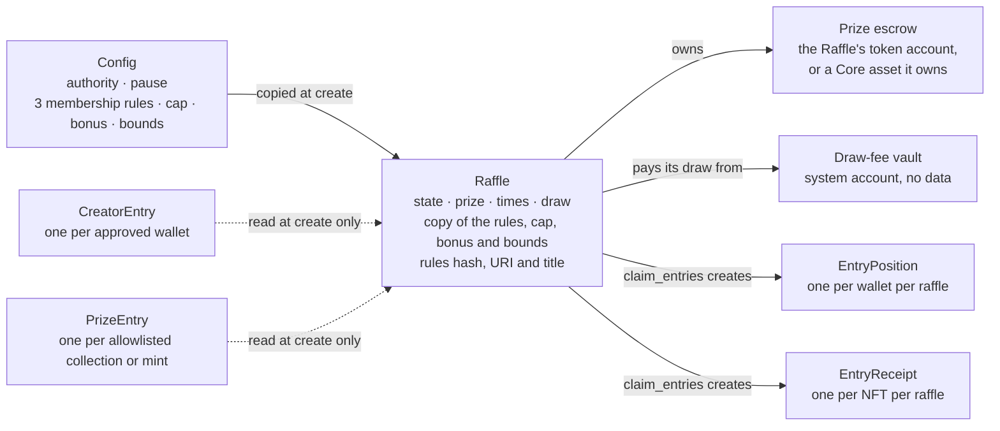
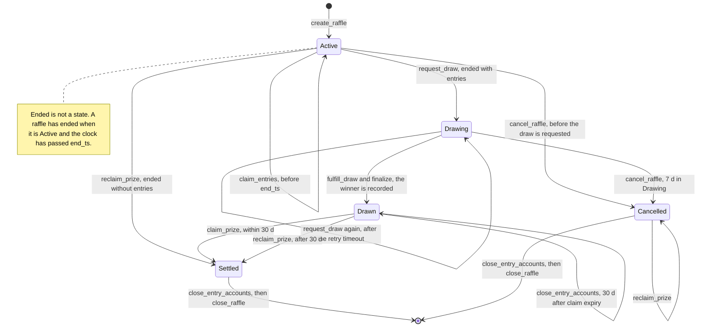

# Account model

|  |  |
| --- | --- |
| Issue | PIG-86 |
| Date | 2026-11-15 |
| Code | `programs/raffles/src/state`, `constants.rs` and `error.rs` |
| Status | The accounts, their constants and the state machine's edges. No instruction uses them yet: each one named below lands with its own issue, from PIG-81 on. |
| Built on | Spec 1.6 §7, holder-proof §5, registries §3, prize escrow §4 and §6, rules §3 and §5, and the PIG-114 and PIG-133 spikes |
| Rent | 5,080 lamports per byte, plus 128 bytes of overhead per account: devnet and mainnet on 2026-11-15 |

## Summary

- **Six account types.** `Config`, `CreatorEntry`, `PrizeEntry`, `Raffle`, `EntryPosition` and `EntryReceipt`. A raffle also has two addresses that hold none of our data: its draw-fee vault and its prize escrow.
- **Every lamport of rent has one fixed address to return to.**
  - Entry accounts name the wallet that paid for them.
  - A raffle names its creator.
  - Registry entries return to the authority.
- **An entrant fronts 0.0025 SOL for a first pig** and 0.0012 SOL for each one after: 0.0132 SOL for ten pigs, 0.0155 SOL at the most. A creator fronts 0.0060 SOL of rent plus the draw fee (section 3).
- **The state machine has five states and six edges** (section 7). "Ended" isn't a state: a raffle has ended when it is still Active and the clock has passed `end_ts`.
- **The tests hold the tables here to the code.** A layout, a size, a rent figure, a seed, a constant, an enum value or a state change can't differ between the two (section 10).
- **Where the design documents left a choice, section 8 records it,** and section 9 lists what each later issue has to keep true.

## 1. Map



Dashed edges are reads. Nothing after `create_raffle` reads `Config`'s rules, cap, bonus or bounds, or either registry, so no admin change reaches a raffle that already exists (spec D14, E-C6, E-C7). Only the pause flag and the authority are read live.

## 2. Addresses

| Address | Seeds | Notes |
| --- | --- | --- |
| `Config` | `[b"config"]` | One per program |
| `CreatorEntry` | `[b"creator", wallet]` | |
| `PrizeEntry` | `[b"prize", [kind], address]` | `kind` is one byte, a `PrizeKind`. An address can have an entry of each kind. |
| `Raffle` | `[b"raffle", creator, nonce]` | `nonce` is a `u64`, little-endian, chosen by the creator |
| Draw-fee vault | `[b"vault", raffle]` | Owned by the system program, no data |
| `EntryPosition` | `[b"position", raffle, wallet]` | |
| `EntryReceipt` | `[b"receipt", raffle, nft]` | `nft` is the mint of a Token Metadata pig, or the asset of a Core pig |
| Token escrow | The Raffle's associated token account for `prize_mint` | Classic Token program. A Core prize has no token account: the Raffle PDA owns the asset. |

- **Every bump is the canonical one,** and each account stores its own. The Raffle also stores its vault's.
- **No two kinds of address can collide.** Seeds are hashed end to end, so two kinds could only meet if one prefix began another, and none does. The spec's unprefixed `[raffle, nft_mint]` and `[raffle, wallet]` shared one address space (PIG-133 §6).
- **A raffle's address is known before it exists.** The rules document names the raffle, and its hash goes into `create_raffle`, so the address can't depend on a counter that another create could move (rules §5).
- **The nonce is the GM period tag.** `raffles-gm` derives it from the period, so a second create for a period fails at `init` for as long as the first raffle exists (rules §6). The issue's "optional GM period tag" needs no field of its own.
- **A nonce can be used again once its raffle is closed.** The address then names a new raffle. Section 9 has what that means for the indexer and the draw.

## 3. Sizes and rent

| Account | Bytes | Rent, lamports | Paid by | Returned to | By |
| --- | ---: | ---: | --- | --- | --- |
| `Config` | 373 | 2,545,080 | The deployer | Nobody | Never closed |
| `CreatorEntry` | 113 | 1,224,280 | The authority | The authority | `creator_remove` |
| `PrizeEntry` | 82 | 1,066,800 | The authority | The authority | `allowlist_remove` |
| `Raffle` | 753 | 4,475,480 | The creator | The creator | `close_raffle` |
| Draw-fee vault | 0 | 650,240 | The creator, as part of the draw fee | The creator | `close_raffle` |
| Token escrow | 165 | 1,488,440 | The creator | The creator | `close_raffle` |
| `EntryPosition` | 132 | 1,320,800 | The wallet | The wallet | `close_entry_accounts` |
| `EntryReceipt` | 105 | 1,183,640 | The wallet | The wallet | `close_entry_accounts` |

Rent is `(128 + bytes) × 5,080` lamports today. Rent per byte has dropped once already, from 6,960, so the instructions read the Rent sysvar and never assume these figures. The design documents still quote the old rate.

**What each actor fronts:**

- **An entrant.** All of it comes back from `close_entry_accounts`.

  | Claim | Accounts | Lamports | SOL |
  | --- | --- | ---: | ---: |
  | A wallet's first pig in a raffle | 1 position, 1 receipt | 2,504,440 | 0.0025 |
  | Each further pig | 1 receipt | 1,183,640 | 0.0012 |
  | Ten pigs, the cap | 1 position, 10 receipts | 13,157,200 | 0.0132 |
  | Twelve pigs, the most: the cap plus two that complete the Full Gang set | 1 position, 12 receipts | 15,524,480 | 0.0155 |

- **A creator.** The Raffle and a token escrow are 5,963,920 lamports (0.0060 SOL); a Core prize needs no token account. The draw fee comes on top. PIG-141 sizes it, and PIG-114 §3 estimates 15,515,720 lamports for three attempts on mainnet, the vault's rent included. `close_raffle` returns the rent and whatever the draw left of the fee.
- **The authority.** 20 creators and 60 prize entries lock 88,493,600 lamports (0.088 SOL), returned as entries are removed.

## 4. Layouts

Anchor accounts, Borsh, little-endian. Offsets count from the start of the account data, discriminator included.

- **`bump` comes first,** at offset 8 of every account.
- **Fixed-size fields come before variable-length ones,** so each has one offset to `memcmp` on. Only the Raffle's `rules_uri` and `title` vary, and they come last.
- **Kinds, states and reasons are a `u8`,** with an enum of the same values next to it in the code (section 5). The program treats a byte it doesn't know as an error.
- **`_reserved` bytes are zero.** They leave room for a later field without a realloc.
- **`SPACE` is the size to allocate:** the discriminator plus Anchor's `INIT_SPACE`.

### Config

The program's settings. `init_config` creates it and nothing closes it.

| Offset | Field | Type | Bytes | Notes |
| ---: | --- | --- | ---: | --- |
| 0 | discriminator | `[u8; 8]` | 8 | `9b0caae01efacc82` |
| 8 | `bump` | `u8` | 1 | |
| 9 | `authority` | `Pubkey` | 32 | The admin: the Squads vault on mainnet (registries §6). It creates raffles without a `CreatorEntry`. |
| 41 | `pending_authority` | `Pubkey` | 32 | Set by `set_authority`, consumed by `accept_authority`. Zero when none is pending. |
| 73 | `paused` | `bool` | 1 | Blocks `create_raffle`, `claim_entries` and `request_draw`, and nothing that pays out (spec §10) |
| 74 | `membership_rules` | `[MembershipRule; 3]` | 225 | Rule `i` is bit `i` of `EntryPosition.collections_seen` |
| 299 | `entry_cap` | `u8` | 1 | Per-NFT entries per wallet per raffle, 1 to `MAX_ENTRY_CAP` |
| 300 | `full_gang_bonus` | `u8` | 1 | Entries the Full Gang bonus adds, on top of the cap |
| 301 | `min_duration` | `u32` | 4 | Seconds |
| 305 | `max_duration` | `u32` | 4 | Seconds |
| 309 | `_reserved` | `[u8; 64]` | 64 | |
| | **total** | | **373** | |

### MembershipRule

How the program recognises one Piggy collection (holder-proof §5). A record inside `Config` and `Raffle`, not an account.

| Offset | Field | Type | Bytes | `TmCreator` | `CoreCollection` |
| ---: | --- | --- | ---: | --- | --- |
| 0 | `kind` | `u8` | 1 | 0 | 1 |
| 1 | `address` | `Pubkey` | 32 | The verified creator | The Core collection |
| 33 | `update_authority` | `Pubkey` | 32 | The metadata update authority | Zero |
| 65 | `symbol` | `[u8; 10]` | 10 | The symbol, padded with zero bytes | Zero |
| | **total** | | **75** | | |

### CreatorEntry

A wallet that may create raffles (registries §3). The account existing is the membership.

| Offset | Field | Type | Bytes | Notes |
| ---: | --- | --- | ---: | --- |
| 0 | discriminator | `[u8; 8]` | 8 | `98376fbe56b7174f` |
| 8 | `bump` | `u8` | 1 | |
| 9 | `wallet` | `Pubkey` | 32 | The approved creator, also the seed |
| 41 | `added_at` | `i64` | 8 | Cluster time of `creator_add` |
| 49 | `label` | `[u8; 32]` | 32 | UTF-8 padded with zero bytes, never empty. A project's name, never personal data. |
| 81 | `_reserved` | `[u8; 32]` | 32 | |
| | **total** | | **113** | |

### PrizeEntry

An asset, or a collection of them, that may be a prize (registries §3). The account existing is the permission.

| Offset | Field | Type | Bytes | Notes |
| ---: | --- | --- | ---: | --- |
| 0 | discriminator | `[u8; 8]` | 8 | `8a222baf2c2b665f` |
| 8 | `bump` | `u8` | 1 | |
| 9 | `kind` | `u8` | 1 | A `PrizeKind`, also a seed |
| 10 | `address` | `Pubkey` | 32 | What the entry admits, read according to `kind`. Also a seed. |
| 42 | `added_at` | `i64` | 8 | Cluster time of `allowlist_add` |
| 50 | `_reserved` | `[u8; 32]` | 32 | |
| | **total** | | **82** | |

### Raffle

One raffle. The creator pays its rent and `close_raffle` returns it. The Raffle PDA is the escrow's authority: the program signs with the Raffle's seeds to move the prize, and with the vault's own seeds to pay for the draw.

| Offset | Field | Type | Bytes | Notes |
| ---: | --- | --- | ---: | --- |
| 0 | discriminator | `[u8; 8]` | 8 | `8f853fad8a0a8ec8` |
| 8 | `bump` | `u8` | 1 | |
| 9 | `vault_bump` | `u8` | 1 | Bump of the draw-fee vault |
| 10 | `creator` | `Pubkey` | 32 | A seed. The only address a reclaimed prize, the vault's remainder and this account's rent go to. It can't enter. |
| 42 | `nonce` | `u64` | 8 | A seed, chosen by the creator |
| 50 | `state` | `u8` | 1 | A `RaffleState` |
| 51 | `cancel_reason` | `u8` | 1 | A `CancelReason` |
| 52 | `escrow_kind` | `u8` | 1 | An `EscrowKind` |
| 53 | `prize_out` | `bool` | 1 | The prize has left escrow. `close_raffle` requires it (prize escrow §6). |
| 54 | `prize_mint` | `Pubkey` | 32 | A classic SPL Token mint, or the Core asset itself |
| 86 | `prize_amount` | `u64` | 8 | Base units escrowed at create: 1 for an NFT or a Core asset |
| 94 | `start_ts` | `i64` | 8 | Cluster time of `create_raffle` |
| 102 | `end_ts` | `i64` | 8 | Entries close and the draw opens. It never moves. |
| 110 | `total_entries` | `u32` | 4 | Entries handed out, bonuses included. The next range starts here. |
| 114 | `open_entry_accounts` | `u32` | 4 | Positions and receipts not yet closed. `close_raffle` requires zero (prize escrow §6). |
| 118 | `draw_fee_lamports` | `u64` | 8 | What the creator put into the vault at create (spec R14) |
| 126 | `draw_requested_at` | `i64` | 8 | Cluster time of the first `request_draw`; zero before. The break-glass cancel counts from it. |
| 134 | `vrf_requests` | `u32` | 4 | Randomness requests so far, re-requests included |
| 138 | `vrf_requested_slot` | `u64` | 8 | Slot of the latest request. The retry timeout counts from it. |
| 146 | `vrf_seed` | `[u8; 32]` | 32 | Seed of the latest request, the only one the draw accepts |
| 178 | `vrf_randomness` | `[u8; 64]` | 64 | The randomness the winner was drawn from; zero until Drawn |
| 242 | `winner_index` | `u32` | 4 | The winning entry, below `total_entries`. Set when Drawn. |
| 246 | `winner` | `Pubkey` | 32 | The wallet of the position that holds `winner_index`. Zero until Drawn, and for good without a draw. |
| 278 | `drawn_at` | `i64` | 8 | Cluster time the raffle became Drawn; zero before. The claim window and the backstop count from it. |
| 286 | `membership_rules` | `[MembershipRule; 3]` | 225 | `Config`'s at create (spec D14). Claims are checked against these. |
| 511 | `entry_cap` | `u8` | 1 | `Config`'s at create, or the creator's lower override (spec D6) |
| 512 | `full_gang_bonus` | `u8` | 1 | `Config`'s at create |
| 513 | `min_duration` | `u32` | 4 | `Config`'s at create: the bound the raffle was checked against |
| 517 | `max_duration` | `u32` | 4 | `Config`'s at create |
| 521 | `_reserved` | `[u8; 32]` | 32 | |
| 553 | `rules_hash` | `[u8; 32]` | 32 | sha256 of the rules document's exact bytes (spec D20). Never zero. |
| 585 | `rules_uri` | `String` | 4 + length, up to 100 | Where the rules document is published: 1 to 96 bytes, `ar://<id>` today |
| 589 + `rules_uri` length | `title` | `String` | 4 + length, up to 68 | The title, as the rules document states it: at most 64 bytes |
| | **total** | | **753** | With both strings at their longest. The account is always allocated at this size. |

### EntryPosition

One wallet's entries in one raffle (spec R4). The wallet's first claim creates it.

| Offset | Field | Type | Bytes | Notes |
| ---: | --- | --- | ---: | --- |
| 0 | discriminator | `[u8; 8]` | 8 | `91b102f4ffdb9c77` |
| 8 | `bump` | `u8` | 1 | |
| 9 | `raffle` | `Pubkey` | 32 | A seed |
| 41 | `wallet` | `Pubkey` | 32 | A seed. Holds the entries, wins if one is drawn, and paid the rent: the only address the close refunds. |
| 73 | `entries_claimed` | `u8` | 1 | Per-NFT entries, which the cap limits. The bonus doesn't count. |
| 74 | `collections_seen` | `u8` | 1 | Bit `i`: an NFT of membership rule `i` was entered. `0b111` is the Full Gang set. |
| 75 | `bonus_awarded` | `bool` | 1 | The Full Gang bonus was added. It is added once. |
| 76 | `range_count` | `u8` | 1 | How many of `ranges` are in use |
| 77 | `ranges` | `[EntryRange; 11]` | 55 | The entry indexes the wallet holds, in claim order |
| | **total** | | **132** | |

- **Why several ranges.** A wallet that claims in several transactions gets a range per claim, because other wallets claim in between. The draw takes the position whose ranges hold `winner_index` (`EntryPosition::holds_entry`).
- **Why 11.** Only a claim that adds entries adds a range. Under a cap of 10 that is at most ten claims of one entry each, plus one claim that adds only the bonus. `MAX_ENTRY_CAP` keeps the cap at 10 or below, so a position can't run out of ranges.

### EntryRange

A run of consecutive entry indexes that one claim added. A record inside `EntryPosition`.

| Offset | Field | Type | Bytes | Notes |
| ---: | --- | --- | ---: | --- |
| 0 | `start` | `u32` | 4 | The first index: `Raffle.total_entries` when the claim ran |
| 4 | `count` | `u8` | 1 | How many entries: at most the cap plus the bonus |
| | **total** | | **5** | |

### EntryReceipt

Marks an NFT as entered in a raffle. The account existing is the mark, so an NFT enters a raffle once, whoever holds it.

| Offset | Field | Type | Bytes | Notes |
| ---: | --- | --- | ---: | --- |
| 0 | discriminator | `[u8; 8]` | 8 | `02cdbff20c47871d` |
| 8 | `bump` | `u8` | 1 | |
| 9 | `raffle` | `Pubkey` | 32 | A seed |
| 41 | `wallet` | `Pubkey` | 32 | Entered the NFT and paid the rent: the only address the close refunds |
| 73 | `nft` | `Pubkey` | 32 | A seed: the Token Metadata mint, or the Core asset |
| | **total** | | **105** | |

- **A receipt starts like a position:** `bump`, `raffle`, `wallet`. Next to the discriminator, a `memcmp` on offset 9 finds a raffle's entry accounts and one on offset 41 a wallet's, and `close_entry_accounts` reads the same two fields whichever kind it is given.
- **Why the raffle and the NFT are stored.** They are the seeds too, and keeping them costs 325,120 lamports of fronted rent per pig.
  - `raffle` stays so that anyone can find a raffle's receipts and close them: the refunds must not depend on the indexer (spec §9).
  - `nft` stays because an address can't be turned back into its seeds. Without it a receipt wouldn't say which NFT it marks, to a wallet, an explorer or the indexer's snapshot diff.

## 5. Enums

Each is one byte in its account. A value is never renumbered or reused; new ones are added.

### RuleKind

`MembershipRule.kind` (holder-proof §5).

| Byte | Name | A Piggy is |
| ---: | --- | --- |
| 0 | `TmCreator` | A Token Metadata NFT with the rule's creator verified, and the rule's update authority and symbol |
| 1 | `CoreCollection` | A Metaplex Core asset whose update authority is the rule's collection |

2 is kept for a rule on a certified Token Metadata collection (holder-proof §6, option B).

### PrizeKind

`PrizeEntry.kind` (registries §3).

| Byte | Name | Admits |
| ---: | --- | --- |
| 0 | `Collection` | Any NFT of a Metaplex Certified Collection, named by its collection mint |
| 1 | `Mint` | One classic SPL Token mint: a single NFT or a fungible token |
| 2 | `CoreCollection` | Any asset of a Metaplex Core collection (spec D22) |

3 is kept for a single Core asset.

### RaffleState

`Raffle.state` (spec §7).

| Byte | Name | Meaning |
| ---: | --- | --- |
| 0 | `Active` | Created, with the prize in escrow. Entries can be claimed until `end_ts`. |
| 1 | `Drawing` | Randomness is requested. The entries are final. |
| 2 | `Drawn` | The winner is recorded and can claim the prize. |
| 3 | `Settled` | The prize left escrow, to the winner or back to the creator. Terminal. |
| 4 | `Cancelled` | The admin cancelled the raffle. Its entries are void. Terminal. |

### EscrowKind

`Raffle.escrow_kind` (prize escrow §4).

| Byte | Name | The Raffle PDA holds the prize |
| ---: | --- | --- |
| 0 | `Token` | In its associated token account for `prize_mint` |
| 1 | `Core` | As the owner of the Core asset `prize_mint` names |

### CancelReason

`Raffle.cancel_reason` (spec E-A1). A code, so the app can word it in any language and nothing free-form goes on-chain.

| Byte | Name | Meaning |
| ---: | --- | --- |
| 0 | `NotCancelled` | The raffle isn't cancelled |
| 1 | `PrizeDefect` | The prize isn't what the rules promise, or can't be given away |
| 2 | `RulesDefect` | The published rules misstate the raffle (spec E-I7) |
| 3 | `EntriesCompromised` | The entries can't be trusted, for example because a membership rule's key leaked (holder-proof §4) |
| 4 | `DrawStuck` | The randomness never arrived: the break-glass cancel (spec E-D5) |
| 255 | `Other` | None of the above |

## 6. Constants

The seven seed prefixes of section 2 are constants too, `CONFIG_SEED` to `RECEIPT_SEED`. All of them are in the IDL's `constants`, except the two marked.

| Constant | Value | Meaning |
| --- | ---: | --- |
| `CLAIM_WINDOW_SECS` | 2,592,000 | 30 days: the winner's claim window, from `drawn_at` (spec D5) |
| `CLOSE_GRACE_SECS` | 2,592,000 | 30 days: from claim expiry to the backstop (spec E-S8) |
| `BREAK_GLASS_DELAY_SECS` | 604,800 | 7 days: from `draw_requested_at` to the break-glass cancel (spec D15) |
| `MEMBERSHIP_RULE_COUNT` | 3 | Rules in `Config` and on each raffle. Not in the IDL. |
| `FULL_GANG` | 7 | `0b111`: `collections_seen` with every rule entered |
| `MAX_ENTRY_CAP` | 10 | The highest cap `Config` may hold |
| `MAX_ENTRY_RANGES` | 11 | Ranges in a position: `MAX_ENTRY_CAP + 1`. Not in the IDL. |
| `MAX_RULES_URI_LEN` | 96 | Bytes |
| `MAX_TITLE_LEN` | 64 | Bytes |

The three timers are constants, not `Config` values, so none can change under a raffle that is already running (spec §15, "claim expiry").

## 7. State machine



### Changes of state

`RaffleState::can_become` has these six edges and no others. Instructions change the state only through `Raffle::transition`, which refuses anything else, so a raffle's state only ever moves forward.

| Edge | Instruction | Caller | Guard, on the Raffle and the clock | Also writes |
| --- | --- | --- | --- | --- |
| Active → Drawing | `request_draw` | Anyone | `now ≥ end_ts` · `total_entries ≥ 1` · not paused | `draw_requested_at` · `vrf_requests` · `vrf_requested_slot` · `vrf_seed` |
| Active → Settled | `reclaim_prize` | Anyone | `now ≥ end_ts` · `total_entries = 0` | `prize_out` |
| Active → Cancelled | `cancel_raffle` | The authority | Before the draw is requested | `cancel_reason` |
| Drawing → Drawn | `fulfill_draw` and finalize | Anyone | The latest request is fulfilled · the position passed holds `winner_index` | `vrf_randomness` · `winner_index` · `winner` · `drawn_at` |
| Drawing → Cancelled | `cancel_raffle` | The authority | `now ≥ draw_requested_at + 7 d` | `cancel_reason` |
| Drawn → Settled | `claim_prize` by the winner, or `reclaim_prize` by anyone | See left | Claim: `now` before claim expiry. Reclaim: from claim expiry on. | `prize_out` |

- **The state changes where the winner is written.** PIG-146 decides whether `fulfill_draw` and finalize are one instruction; either way `winner`, `drawn_at` and Drawn land together (spec §8).
- **A raffle that settles without a draw keeps `winner` at zero.**

### Instructions that leave the state alone

| Instruction | Allowed when | Writes |
| --- | --- | --- |
| `claim_entries` | Active · `now < end_ts` · not paused | `total_entries` · `open_entry_accounts` · the wallet's position and receipts |
| `request_draw`, again | Drawing · the retry timeout has passed since `vrf_requested_slot` · the latest request is unfulfilled · not paused | `vrf_requests` · `vrf_requested_slot` · `vrf_seed` |
| `reclaim_prize` | Cancelled · `prize_out` unset | `prize_out` |
| `close_entry_accounts` | Settled or Cancelled, or Drawn from the backstop on | `open_entry_accounts` |
| `close_raffle` | Settled or Cancelled · `prize_out` set · `open_entry_accounts = 0` | Closes the Raffle, its vault and its token escrow |

### Times the clock derives

| Name | Is | In code |
| --- | --- | --- |
| Ended | Active and `now ≥ end_ts` | `Raffle::has_ended`; before it, `Raffle::is_live` |
| Claim expiry | `drawn_at + CLAIM_WINDOW_SECS`, while Drawn | `Raffle::claim_expires_at` |
| Backstop | Claim expiry `+ CLOSE_GRACE_SECS`, while Drawn | `Raffle::backstop_at` |
| Break-glass | `draw_requested_at + BREAK_GLASS_DELAY_SECS` | PIG-152 |

- **Claim expiry and the backstop exist only while a raffle is Drawn.** Both helpers return `None` in every other state. With `drawn_at` still zero, a deadline computed anyway would lie in 1970, and a guard written as `now ≥ deadline` would open on raffles that were never drawn.
- **Entry accounts can close in both terminal states, and at the backstop** (spec R2). Settled and Cancelled allow it at once. A raffle stuck in Drawn, because its prize can't move, allows it from the backstop on and stays Drawn.
- **No clock moves a raffle out of Drawing.** It leaves by the draw, or by the authority's break-glass cancel (spec E-D5). An ended raffle whose draw can't be requested, under a pause for example, waits for the authority in the same way. Until then the entrants' rent waits too (section 9).
- **The break-glass delay counts from the first request,** not the latest. A re-request is permissionless, so a clock that restarted with each one could be held back for ever.
- **Pause never moves a time.** It blocks `create_raffle`, `claim_entries` and `request_draw`, and `end_ts` keeps running (spec E-D10).

## 8. Where this differs from the design documents

Choices the designs left to this issue, and places where a later finding replaced an earlier text.

| Topic | The designs say | The model has | Why |
| --- | --- | --- | --- |
| Entry seeds | `[raffle, nft_mint]` and `[raffle, wallet]` (spec §5, §7, §15) | `[b"receipt", raffle, nft]` and `[b"position", raffle, wallet]` | One address space would let a wallet collide with an NFT's receipt (PIG-133 §6) |
| Raffle seeds | "Such as `[b"raffle", creator, nonce]`" (rules §5) | Exactly that, with a `u64` nonce | The address is known before create |
| GM period tag | An optional field (the issue) | The nonce | Rules §6: as a seed it also stops a second create for the period while the first raffle exists |
| Escrow address | "Escrow ATA" as a Raffle field (the issue) | Not stored | It derives from the Raffle's address and `prize_mint`, so a field would cost 32 bytes and say nothing new |
| Title and description | In `create_raffle`'s instruction data, "or the Raffle PDA" (architecture §9, flag 1) | `title` on the Raffle, at most 64 bytes. The description isn't stored. | The rules page checks the document's title against the chain while the raffle is live (rules §4). The description is only shown, so it rides in instruction data and `RaffleCreated` (PIG-141), and the rules document carries it under `rules_hash`. |
| Prize amount | Cross-checked against `RaffleCreated` (rules §4) | `prize_amount` on the Raffle too | A live raffle can be checked from its account. The escrow's balance can't stand in: anyone can add to it. |
| Start time | "Recorded on-chain" (rules template §2) | `start_ts` on the Raffle | The duration bounds are checked against it |
| Duration bounds | Unspecified; the claim spike used `i64` | `u32` seconds | They can't be negative, and a `u32` is a plain number in a TypeScript client |
| Draw fee | "Deposited into the raffle" (spec §8) | In a vault PDA; the Raffle records the amount | The request is paid through the system program, where only an account without data can pay (PIG-114 §3) |
| VRF state | Switchboard On-Demand (spec D3) | A seed, a request count, the latest request's slot and 64 bytes of randomness | Switchboard shut down; ORAO is the provider (PIG-114). The fields are what its request and result are. |
| Break-glass clock | "7 d stuck in Drawing" (spec E-D5) | `draw_requested_at`, written by the first request only | Section 7 |
| Winning index | Recomputable (spec §8) | `winner_index` on the Raffle too | The draw's result can be read without redoing the modulo |
| Cancel reason | "Reason recorded" (spec E-A1) | A `CancelReason` byte | Section 5 |
| Rent payer | "Each account records its payer" (spec §9, R4) | `wallet`, which is also the claimer | In v1 the wallet that claims is the one that pays (spec D12 defers delegates). A second key would cost each entrant 32 more bytes of rent per account. |
| Entry cap | A `Config` value (spec D1) | A `Config` value, 10 at most | Positions are sized for 11 ranges (PIG-133 §6). A higher cap needs a program upgrade. |
| Admin | "Admin authority" (the issue) | `authority` and `pending_authority` | The two-step transfer (registries §4) |
| Enums | "State enum" (the issue) | `u8` fields with enums beside them | Registries §3: the byte values stay explicit and stable |
| `bump` | First in the registry entries (registries §3) | First in every account | One convention |
| Reserved bytes | 32 in each registry entry (registries §3) | Also 64 in `Config` and 32 in the Raffle; none in the entry accounts | A Raffle may need a field while it is running. Entrants front the entry accounts' rent, so those stay minimal. |
| Rent figures | 6,960 lamports per byte | 5,080 | Section 3 |

## 9. What the later issues have to keep true

- **`init_config` and `update_config` (PIG-81).**
  - `entry_cap` is 1 to `MAX_ENTRY_CAP`.
  - `entry_cap + full_gang_bonus` fits a `u8`: it is the most one `EntryRange.count` holds.
  - `0 < min_duration ≤ max_duration`.
  - The membership rules pass holder-proof §5's checks.
- **Registry instructions (PIG-140).** The entries are registries §3's layouts, byte for byte.
- **`create_raffle` (PIG-85, PIG-141, PIG-142).**
  - Every field is written: `start_ts` from the clock, the copy of `Config`, `entry_cap` after the override, `prize_amount`, `escrow_kind`.
  - `rules_uri` is 1 to `MAX_RULES_URI_LEN` bytes, `rules_hash` isn't zero, `title` is at most `MAX_TITLE_LEN` bytes.
  - The token escrow is created idempotently. The rules document publishes the raffle's address before the raffle exists, so anyone can create the escrow first, and a plain create would then fail.
  - The vault is funded with `draw_fee_lamports`. Lamports already sent to its address are no obstacle.
- **`claim_entries` (PIG-84, PIG-143, PIG-144, PIG-145).**
  - Receipts are found with `find_program_address` and created with `create_account_allow_prefund` (PIG-133 §6).
  - Each new position and each new receipt adds one to `open_entry_accounts`.
  - A claim that adds entries appends one range, starting at `total_entries`.
  - The wallet that signs pays the rent of every account the claim creates. The model has no separate payer (section 8).
- **The draw (PIG-83, PIG-146, PIG-152).**
  - Only the first request writes `draw_requested_at`.
  - A pause blocks `request_draw` whole, the re-request included (spec §10).
  - The position passed as the winner's belongs to this raffle and holds `winner_index`.
  - PIG-152 sets the retry timeout, in slots from `vrf_requested_slot`.
  - The VRF seed never repeats for a later raffle at the same address (PIG-114 §3). A reused nonce gives one; mixing the slot hash into the seed already covers it.
- **`cancel_raffle` (PIG-152).**
  - It writes a `cancel_reason` other than `NotCancelled`.
  - The break-glass edge counts from `draw_requested_at`.
  - PIG-152 decides whether the break-glass cancel also requires the latest request to be unfulfilled. PIG-114 §3 requires that of a re-request, for a reason that applies here as well: a result that is already public should stand.
- **`claim_prize` and `reclaim_prize` (PIG-82).**
  - Both set `prize_out`.
  - Both pay out the escrow's whole balance, not `prize_amount`. Anyone can send tokens to the escrow.
  - The claim window comes from `claim_expires_at`, which is `None` unless the raffle is Drawn.
- **`close_entry_accounts` (PIG-147).**
  - It checks each account's type and `raffle`, refunds only its `wallet`, and subtracts from `open_entry_accounts`.
  - On a raffle that isn't terminal it opens only from `backstop_at`, which is `None` unless the raffle is Drawn.
  - It closes each account completely, as Anchor's `close` does: lamports out, data cleared, owner back to the system program. The accounts arrive as remaining accounts, so this part is hand-written. An account that only lost its lamports could be funded again in the same transaction and outlive its raffle. At a reused raffle address, a position that survived would hold entries it never claimed there.
- **`close_raffle` (PIG-153).**
  - It requires a terminal state, `prize_out` and `open_entry_accounts = 0`, and pays only `creator`.
  - It empties the token escrow before closing it. Tokens can arrive after the payout too, and a token account with a balance doesn't close: one base unit would hold the creator's rent for good.
  - A request that the provider fulfils after the close refunds its rent to the vault's address (PIG-114 §2.1), which nothing empties by then. `creator` and `nonce` still derive that address, so an instruction can return those lamports to the creator later. PIG-153 decides whether to add one.
- **The IDL (PIG-117).**
  - Anchor lists an account in the IDL only once an instruction's accounts struct names it. Today the IDL has the constants and the errors, and no account.
  - `EntryReceipt` will never be listed: claims and closes pass receipts as remaining accounts. The claim spike's IDL shows it, with `Config`, `EntryPosition` and `Raffle` only. A decoder takes the receipt from this document or from the crate.
  - The IDL shows the enums as `u8`. Their values are in section 5.
- **The indexer (PIG-118, PIG-119, PIG-78).**
  - The `memcmp` offsets and discriminators are in section 4.
  - A raffle's address can name a second raffle after the first is closed (section 2). History keyed by address alone would merge the two; the transaction that created each tells them apart.
  - A Settled raffle's account doesn't say who took the prize. `winner` stays set when the creator reclaims after the claim window, so only the events tell a claim from a reclaim.
- **The app and `raffles-gm` (PIG-73, PIG-124).** They pick a nonce the creator hasn't used before: a random one, or the GM period.
- **The design documents.** They belong to piggygang/raffles, so these are proposals:
  - The prefixed seeds in spec §5, §7 and §15.
  - Today's rent in holder-proof §5, registries §3 and rules §3.
  - Section 8's rows.
  - Spec §9 says no path leaves entrant rent locked. Two wait for the authority (section 7): a raffle in Drawing whose randomness never arrives, and an ended raffle whose draw can't be requested. Whether a permissionless cancel after a longer delay should cover them is the spec's call. The model already has what one would need: `end_ts`, `draw_requested_at`, both cancel edges and `DrawStuck`.

## 10. Tests

```sh
cargo test -p raffles
```

- **Layout.** For each account, a test in `programs/raffles/src/state` lists the fields in order, and the compiler checks each name and type. The test checks the list against the bytes the program writes: the discriminator, each field at its offset, and the total. The table in section 4 has to be exactly those rows, and the bytes have to read back as the same account.
- **Enums.** Every byte of section 5 converts both ways, every other byte is an error, and each table has to be exactly those values.
- **State machine.** All 25 pairs of states are checked against the six edges, and section 7's table of state changes has to be exactly those edges.
- **Addresses and constants.** The tables of sections 2 and 6 are rebuilt from the constants.
- **Sizes and rent.** Section 3's tables are recomputed from the account sizes at 5,080 lamports per byte. That rate is the one read from devnet and mainnet, and the only number here that the tests take on trust.

Each table is compared whole, up to its last column: a row the code doesn't back fails as surely as a missing one. The last column and the text around the tables are prose, which no test reads.

LiteSVM 0.16's Rent sysvar still has the old rate, 6,960 lamports per byte. A test that checks lamports inside the VM therefore sees larger figures than section 3, unless it sets the sysvar first.

A change to an account fails these tests until this document says the same.
